# 企业朋友圈系统设计方案

## 1. 系统整体架构

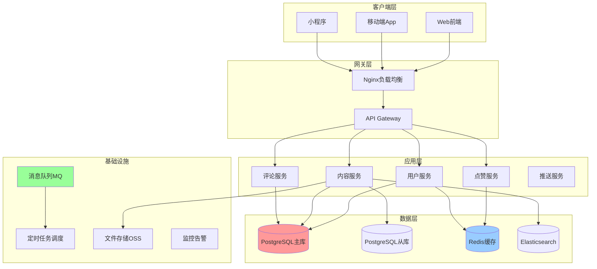

## 2. 数据库设计

### 2.1 ER图

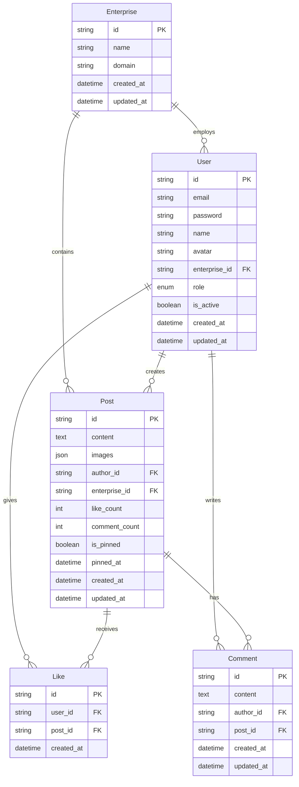

### 2.2 核心表结构

#### 企业表 (enterprises)
| 字段 | 类型 | 说明 | 索引 |
|------|------|------|------|
| id | VARCHAR(30) | 主键 | PRIMARY |
| name | VARCHAR(100) | 企业名称 | UNIQUE |
| domain | VARCHAR(100) | 企业域名 | UNIQUE |
| created_at | TIMESTAMP | 创建时间 | - |

#### 用户表 (users)  
| 字段 | 类型 | 说明 | 索引 |
|------|------|------|------|
| id | VARCHAR(30) | 主键 | PRIMARY |
| email | VARCHAR(100) | 邮箱 | UNIQUE |
| enterprise_id | VARCHAR(30) | 企业ID | INDEX |
| name | VARCHAR(50) | 用户名 | - |
| role | ENUM | 角色(ADMIN/EMPLOYEE) | - |

#### 内容表 (posts)
| 字段 | 类型 | 说明 | 索引 |
|------|------|------|------|
| id | VARCHAR(30) | 主键 | PRIMARY |
| content | TEXT | 内容 | - |
| author_id | VARCHAR(30) | 作者ID | - |
| enterprise_id | VARCHAR(30) | 企业ID | INDEX |
| like_count | INT | 点赞数 | - |
| is_pinned | BOOLEAN | 是否置顶 | - |
| created_at | TIMESTAMP | 创建时间 | INDEX |

**复合索引策略：**
- `(enterprise_id, created_at)` - 企业内容时间排序
- `(enterprise_id, is_pinned, like_count)` - 置顶内容排序
- `(created_at, like_count)` - 自动置顶计算

## 3. 自动置顶算法设计

### 3.1 置顶算法流程图

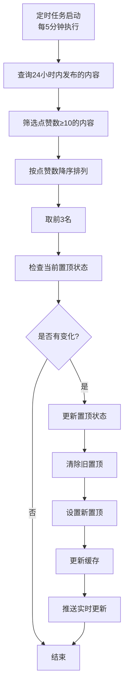

### 3.2 置顶算法实现逻辑

```sql
-- 查询候选置顶内容
SELECT id, like_count, created_at 
FROM posts 
WHERE enterprise_id = ? 
  AND created_at >= NOW() - INTERVAL '24 HOURS'
  AND like_count >= 10
ORDER BY like_count DESC, created_at DESC
LIMIT 3;

-- 更新置顶状态
UPDATE posts 
SET is_pinned = false, pinned_at = null 
WHERE enterprise_id = ? AND is_pinned = true;

UPDATE posts 
SET is_pinned = true, pinned_at = NOW() 
WHERE id IN (?, ?, ?);
```

## 4. 系统交互时序图

### 4.1 发布内容流程

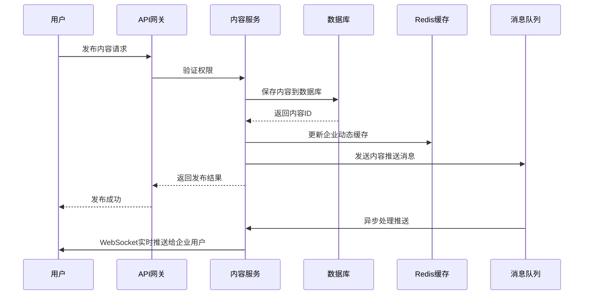

### 4.2 点赞和置顶流程

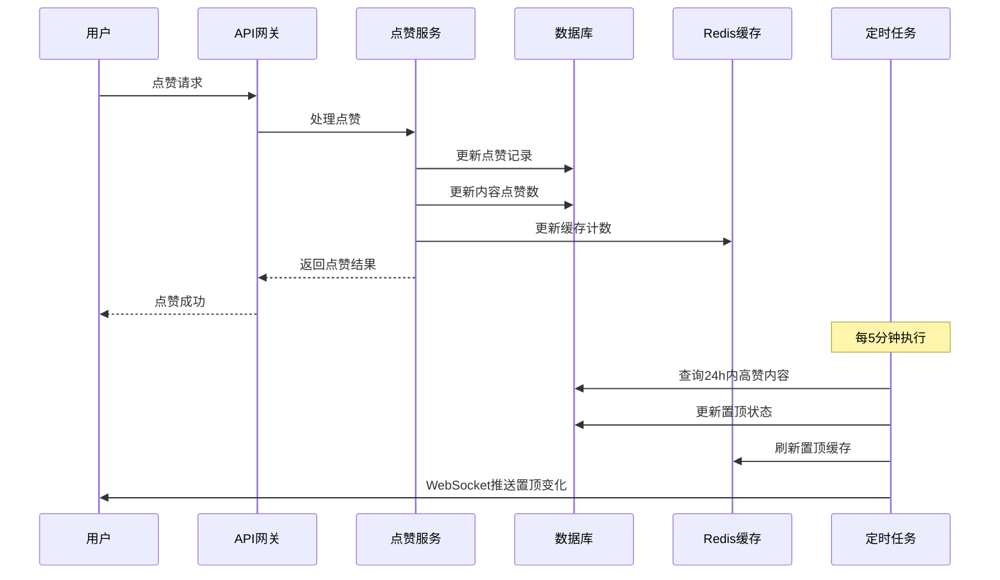

## 5. 核心功能设计

### 5.1 权限控制设计

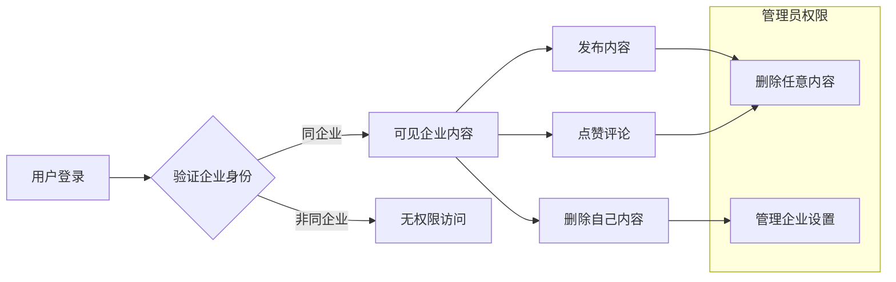

### 5.2 内容可见性规则

| 角色 | 查看权限 | 发布权限 | 删除权限 | 管理权限 |
|------|----------|----------|----------|----------|
| 企业员工 | 同企业内容 | ✓ | 自己的内容 | ✗ |
| 企业管理员 | 同企业内容 | ✓ | 所有企业内容 | ✓ |
| 其他企业用户 | ✗ | ✗ | ✗ | ✗ |

## 6. 高并发和性能优化方案

### 6.1 缓存策略

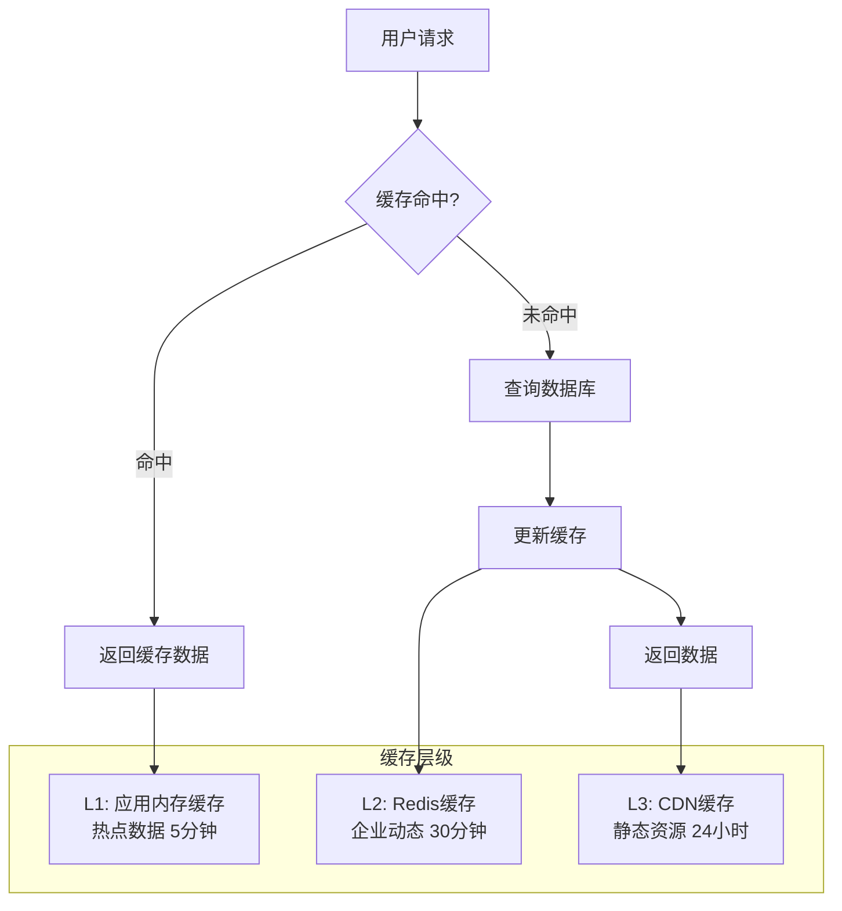

### 6.2 数据分片策略

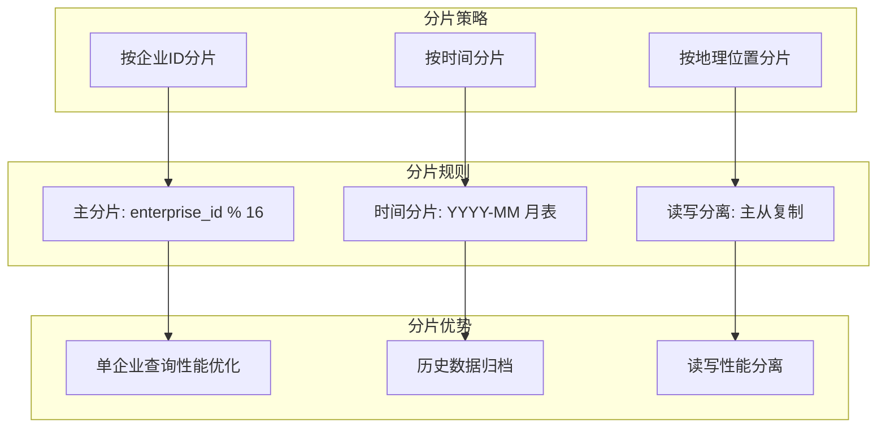

## 7. 系统容量规划

### 7.1 数据量估算

| 维度 | 数值 | 计算依据 |
|------|------|----------|
| 企业数量 | 1万 | 给定 |
| 日活用户 | 500万 | 给定，平均每企业500用户 |
| 日新增内容 | 50万条 | 给定 |
| 年内容总量 | 1.8亿条 | 50万 × 365天 |
| 单条内容存储 | ~2KB | 文本+元数据 |
| 年存储需求 | ~360GB | 1.8亿 × 2KB |

### 7.2 性能指标设计

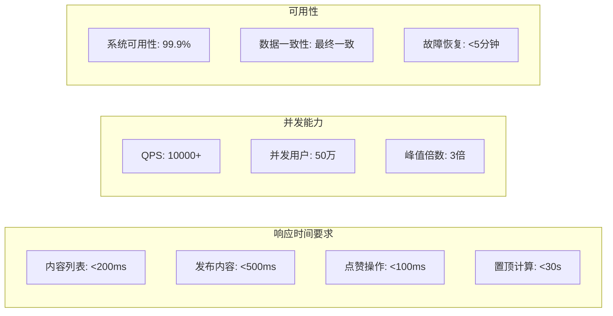

## 8. 核心算法设计

### 8.1 置顶算法详细设计

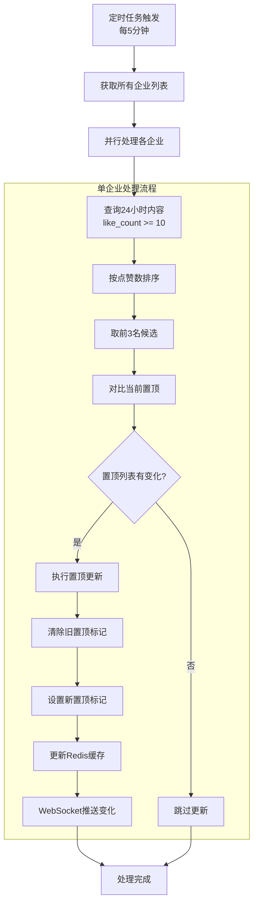

### 8.2 置顶算法优化策略

| 优化点 | 策略 | 效果 |
|--------|------|------|
| 查询优化 | 预计算热门内容 | 减少实时计算压力 |
| 缓存策略 | Redis存储置顶结果 | 快速响应查询 |
| 批量处理 | 企业级并行处理 | 提高处理效率 |
| 增量更新 | 只更新有变化的企业 | 减少无效操作 |

## 9. API接口设计

### 9.1 核心接口规范

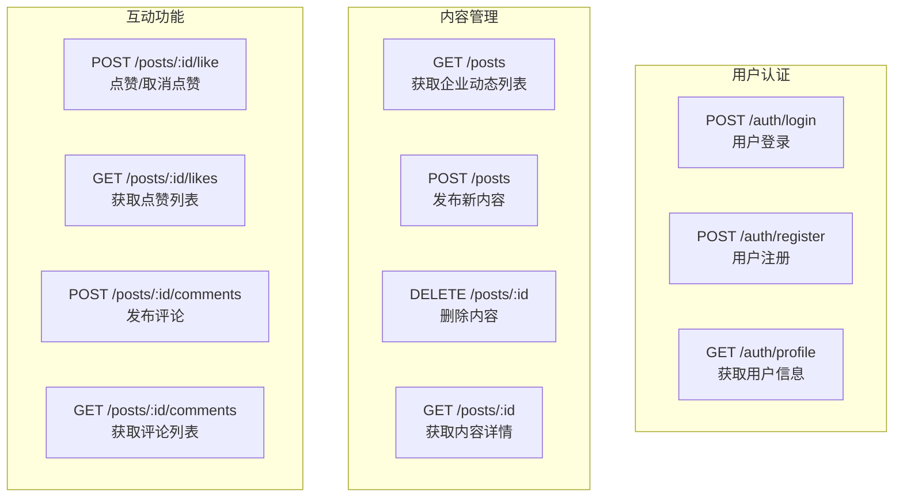

### 9.2 接口响应格式

```json
{
  "code": 200,
  "message": "success",
  "data": {
    "posts": [
      {
        "id": "post_123",
        "content": "企业动态内容",
        "images": ["url1", "url2"],
        "author": {
          "id": "user_456",
          "name": "张三",
          "avatar": "avatar_url"
        },
        "like_count": 15,
        "comment_count": 3,
        "is_pinned": true,
        "has_liked": false,
        "created_at": "2024-01-15T10:30:00Z"
      }
    ],
    "pagination": {
      "page": 1,
      "size": 20,
      "total": 100,
      "has_more": true
    }
  }
}
```

## 10. 实时推送设计

### 10.1 WebSocket架构

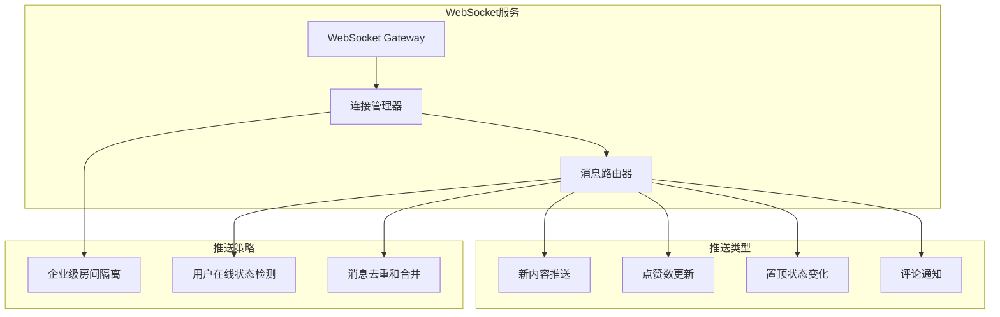

## 11. 性能优化方案

### 11.1 读写分离架构

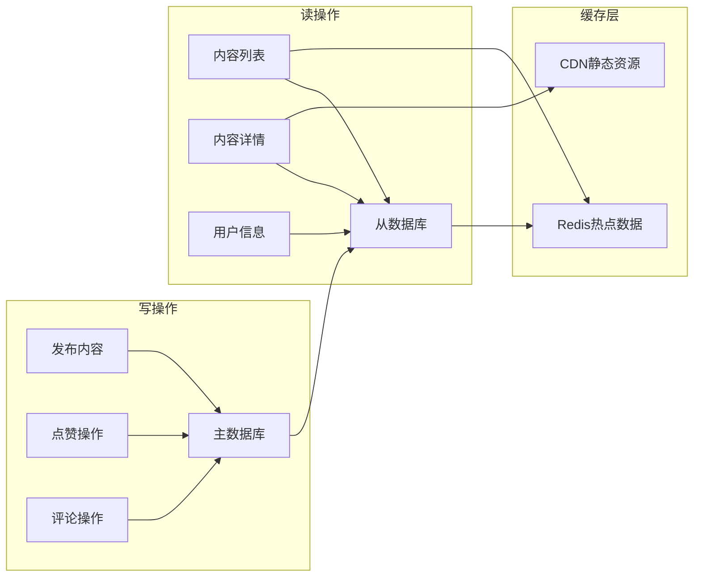

### 11.2 缓存策略详细设计

| 缓存类型 | 存储内容 | 过期时间 | 更新策略 |
|----------|----------|----------|----------|
| 热点内容 | 置顶帖子、热门帖子 | 30分钟 | 写入时更新 |
| 用户信息 | 用户基本信息 | 1小时 | 修改时失效 |
| 企业动态 | 最新20条动态 | 15分钟 | 新发布时更新 |
| 点赞计数 | 实时点赞数 | 5分钟 | 点赞时增量更新 |

## 12. 扩展性设计

### 12.1 微服务拆分方案

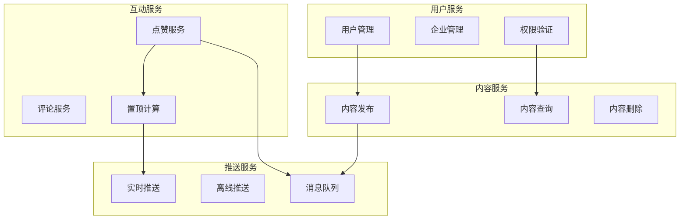

### 12.2 数据库分片策略

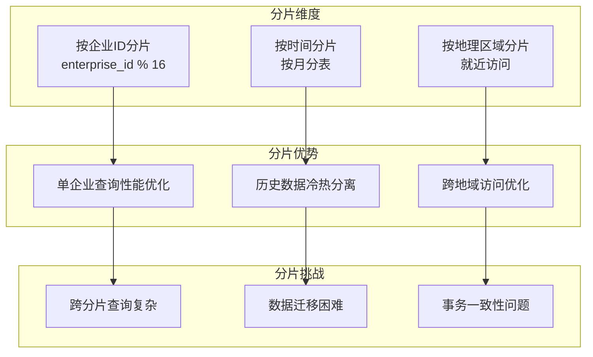

## 13. 监控和运维

### 13.1 关键指标监控

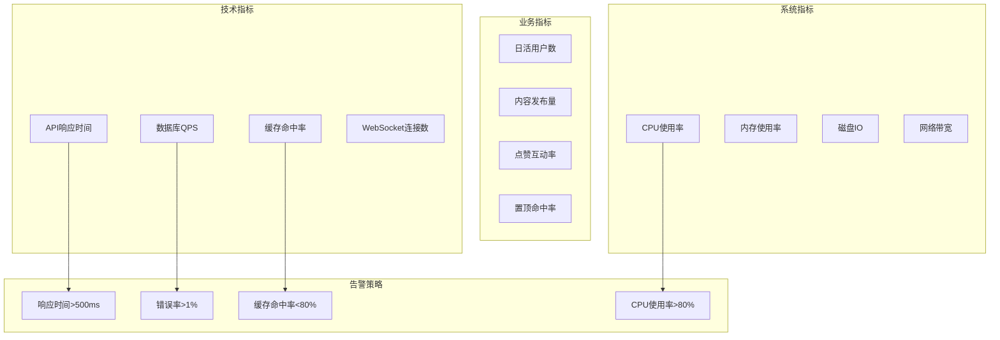

## 14. 部署架构

### 14.1 生产环境部署图

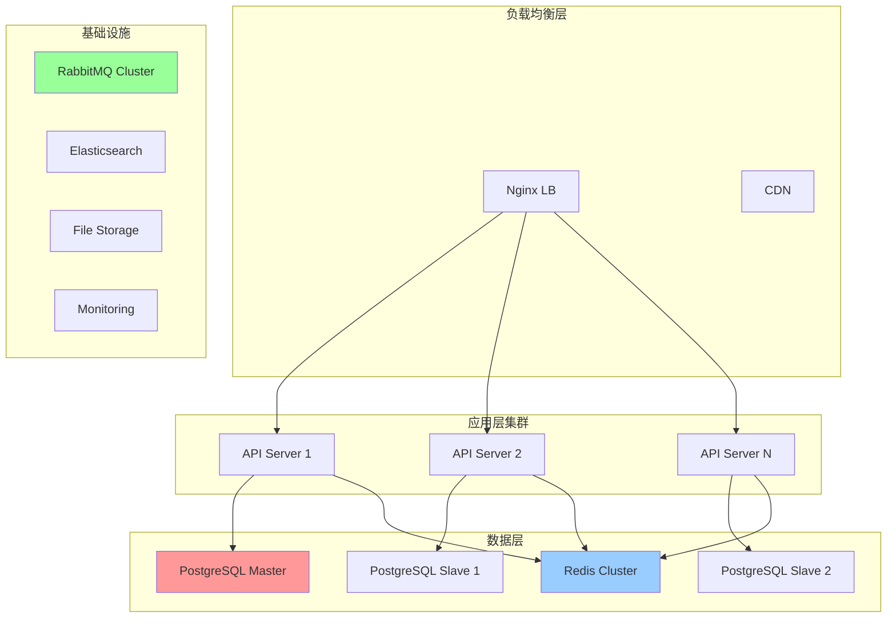

这个设计方案涵盖了企业朋友圈的核心功能、性能优化、扩展性考虑和运维监控，能够支撑1万企业、500万日活用户和50万日新增内容的业务规模。

<function_calls>
<invoke name="todo_write">
<parameter name="merge">true