# 企业朋友圈系统设计方案

## 一、系统概述

基于CQRS（Command Query Responsibility Segregation）模式设计的企业朋友圈系统，支持发布、删除、点赞、评论等功能，并实现热门内容自动置顶机制。

## 二、核心需求分析

### 功能需求
- 企业用户发布/删除内容
- 同企业成员内容互相可见
- 点赞功能
- 24小时内点赞数超过10的内容，前三名自动置顶
- 评论功能（可选）

### 数据规模
- 企业数量：1万
- 每日新增内容：50万条
- 日活用户数：500万

## 三、CQRS架构设计

### 3.1 整体架构图

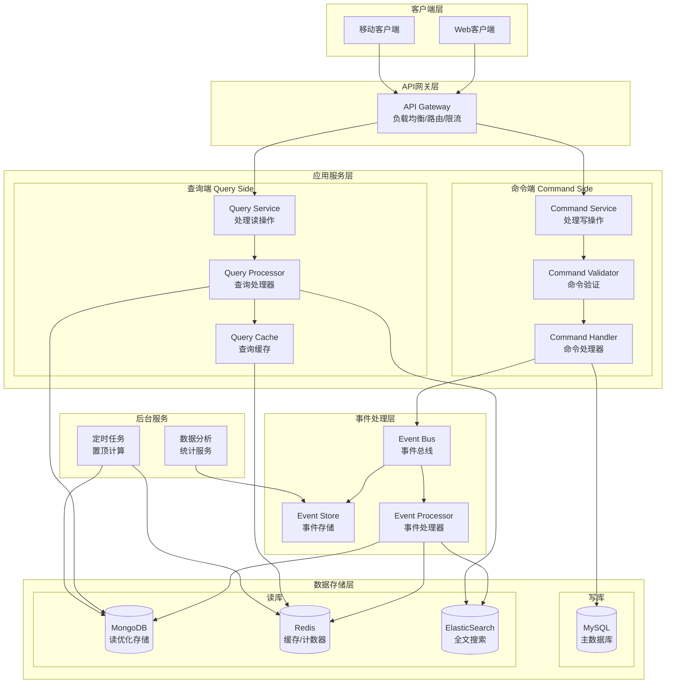

### 3.2 命令处理流程

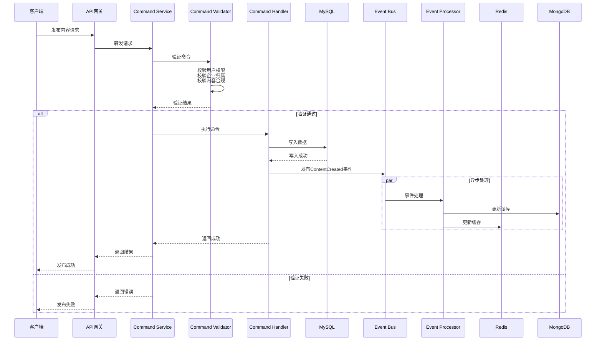

### 3.3 查询处理流程

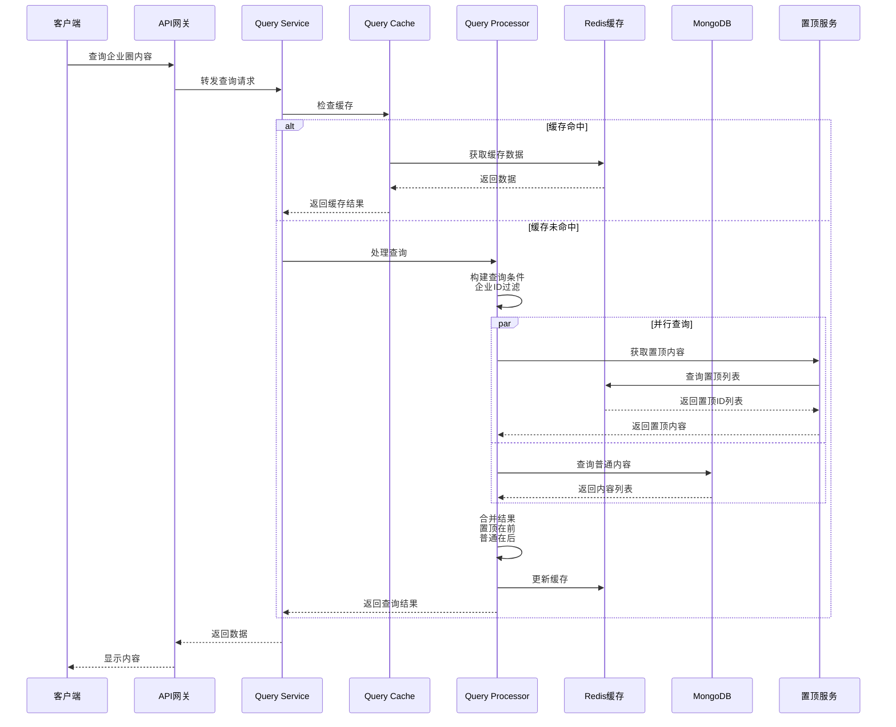

### 3.4 点赞处理流程

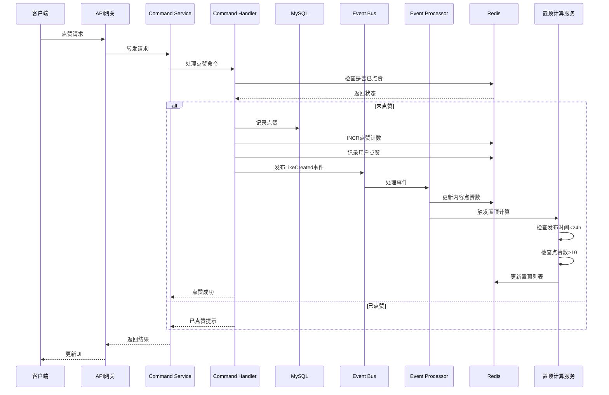

### 3.5 置顶计算流程

```mermaid
flowchart TB
    Start([定时任务触发<br/>每5分钟])
    
    Start --> GetRecent[获取24小时内的内容]
    GetRecent --> Filter[过滤点赞数>10的内容]
    
    Filter --> GroupByCompany[按企业分组]
    GroupByCompany --> SortByLikes[按点赞数排序]
    
    SortByLikes --> SelectTop3[选取前3名]
    SelectTop3 --> UpdateRedis[更新Redis置顶列表]
    
    UpdateRedis --> InvalidateCache[失效相关缓存]
    InvalidateCache --> NotifyClients[通知客户端更新]
    
    NotifyClients --> End([结束])
    
    subgraph "数据结构"
        RedisStructure[Redis数据结构<br/>Key: top:company:{companyId}<br/>Value: Sorted Set<br/>Score: 点赞数<br/>Member: 内容ID]
    end
```

## 四、数据模型设计

### 4.1 命令端数据模型（MySQL）

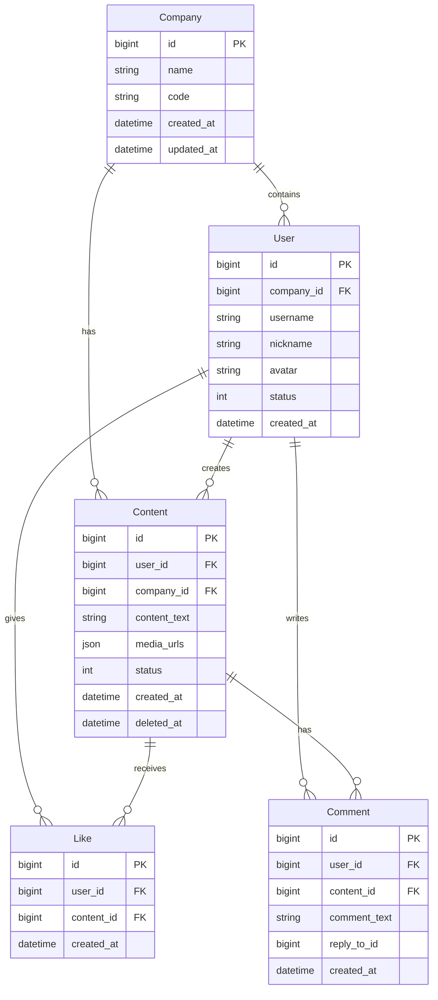

### 4.2 查询端数据模型（MongoDB）

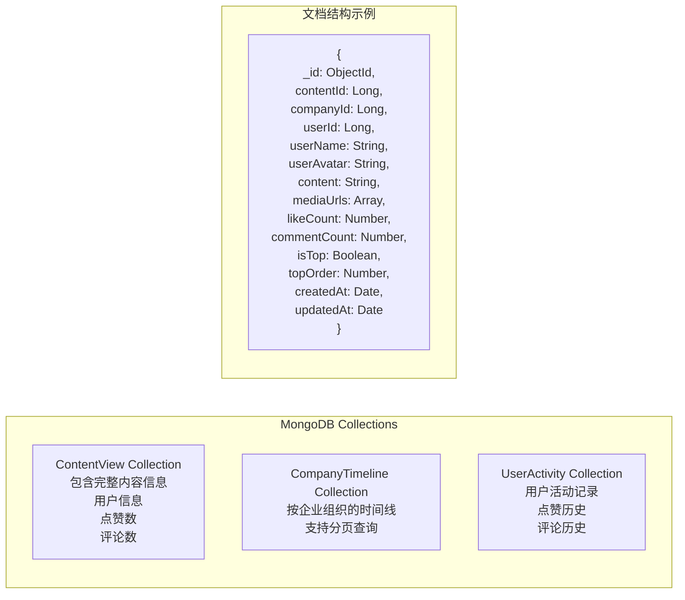

### 4.3 缓存数据结构（Redis）

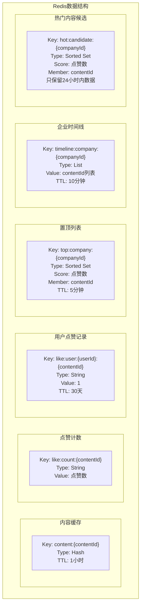

## 五、事件驱动设计

### 5.1 事件流转图

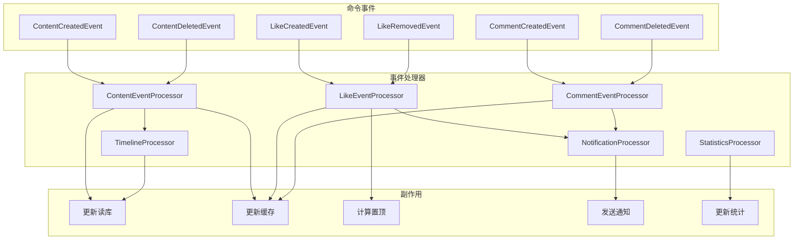

### 5.2 事件存储设计

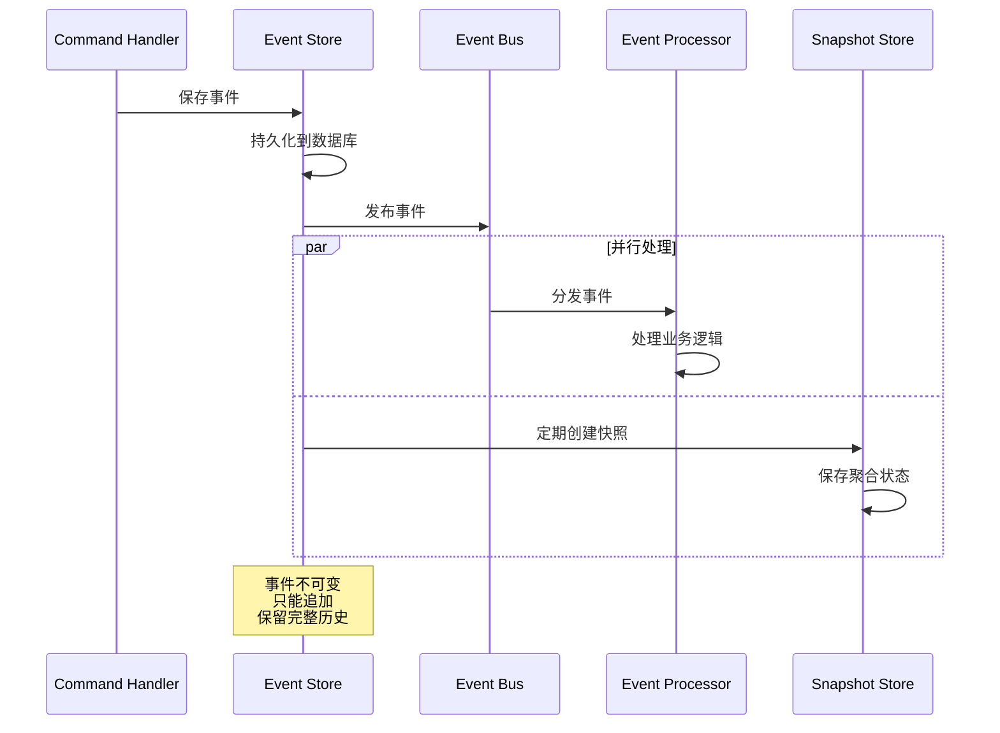

## 六、性能优化策略

### 6.1 读写分离架构

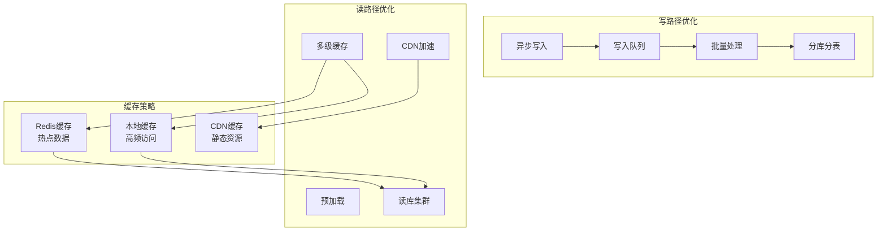

### 6.2 数据分片策略

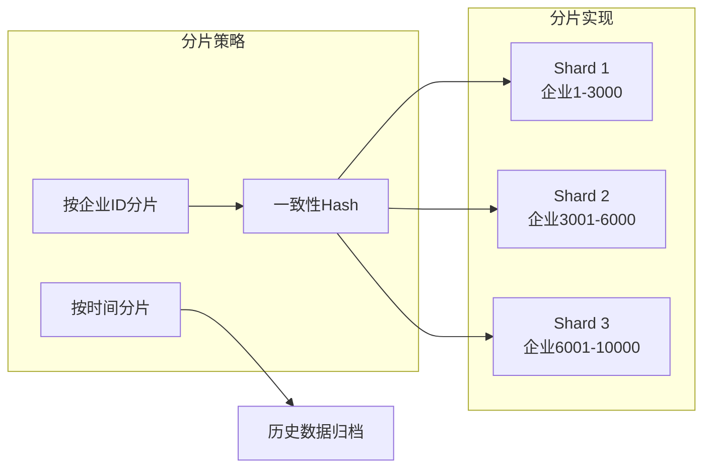

## 七、高可用设计

### 7.1 容错机制

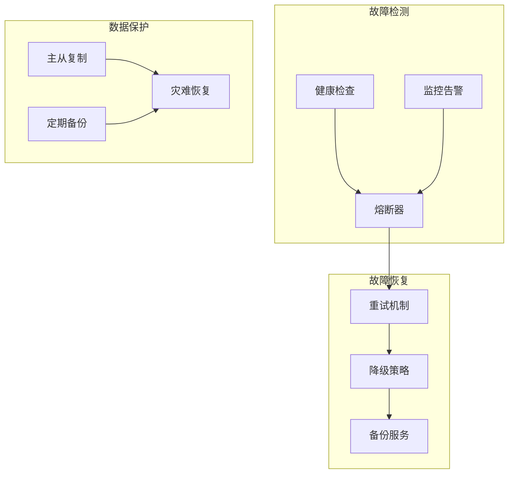

### 7.2 服务降级流程

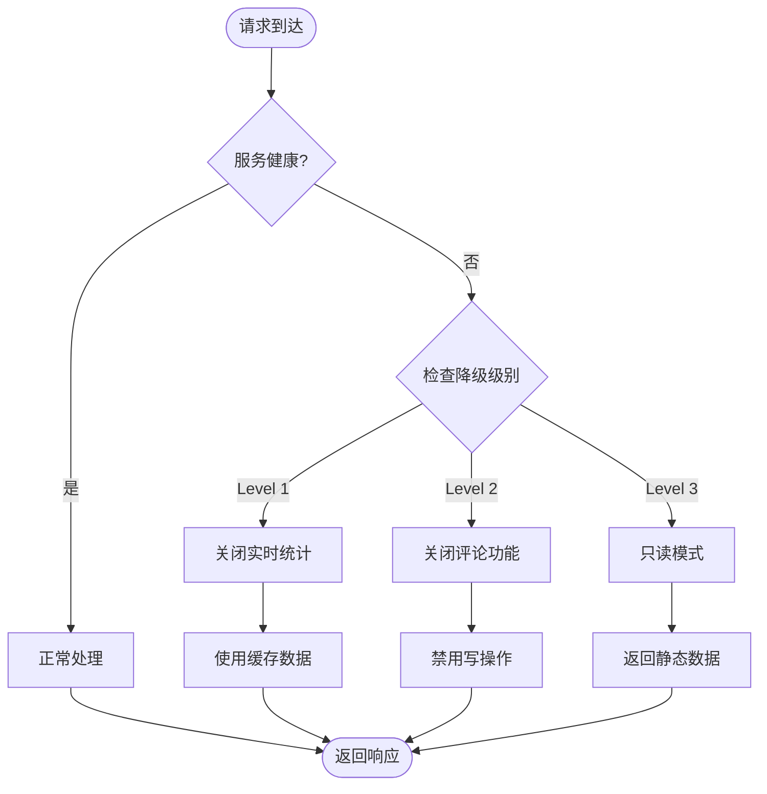

## 八、扩展性设计

### 8.1 水平扩展方案

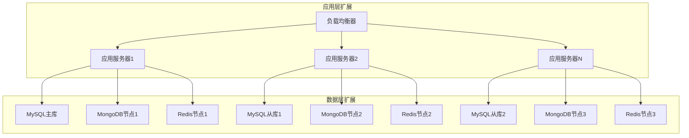

## 九、监控与运维

### 9.1 监控体系

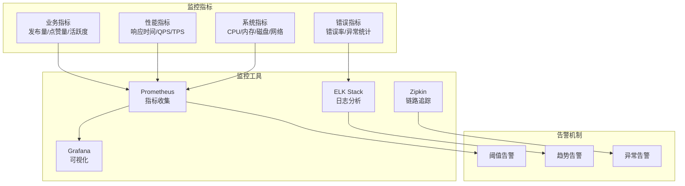

## 十、安全设计

### 10.1 安全架构

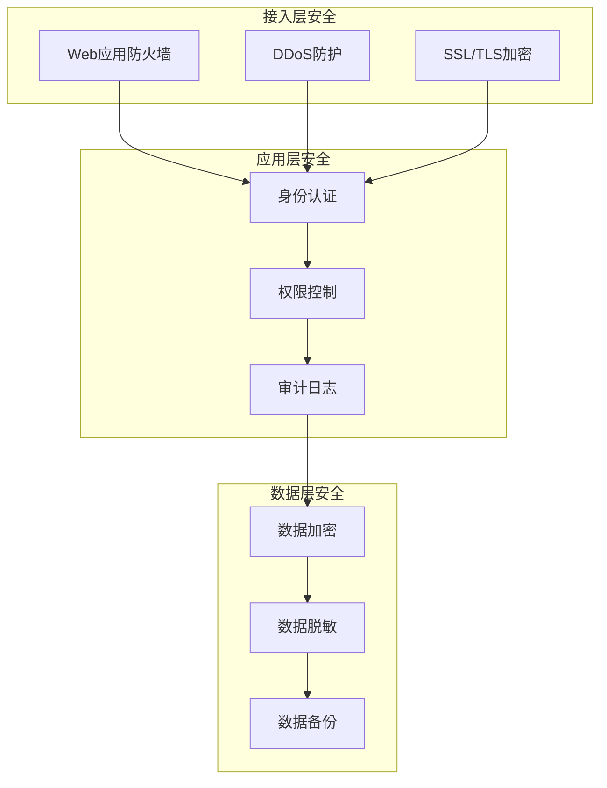

## 十一、技术选型建议

### 核心技术栈
- **编程语言**: Java/Go (高性能、高并发)
- **Web框架**: Spring Boot/Gin
- **消息队列**: Kafka/RabbitMQ
- **缓存**: Redis Cluster
- **主数据库**: MySQL (分库分表)
- **读数据库**: MongoDB
- **搜索引擎**: ElasticSearch
- **监控**: Prometheus + Grafana
- **容器化**: Docker + Kubernetes
- **服务网格**: Istio (可选)

### 关键中间件配置
- **MySQL**: 主从复制 + 读写分离
- **Redis**: 集群模式 + 持久化
- **Kafka**: 多分区 + 多副本
- **MongoDB**: 副本集 + 分片集群

## 十二、总结

本设计方案基于CQRS架构模式，通过读写分离、事件驱动、多级缓存等技术手段，能够有效支撑：
- 1万家企业
- 每日50万条新增内容
- 500万日活用户

系统具备良好的扩展性、高可用性和高性能，能够满足企业朋友圈的业务需求。