# 企业朋友圈系统架构设计 (CQRS)

## 系统概述

基于CQRS（Command Query Responsibility Segregation）模式设计的企业朋友圈系统，支持高并发读写分离，满足以下需求：

- 企业用户发布/删除内容
- 同企业成员可见
- 点赞功能
- 智能置顶（24小时内点赞数前三自动置顶）
- 评论功能（可选）

## 整体架构

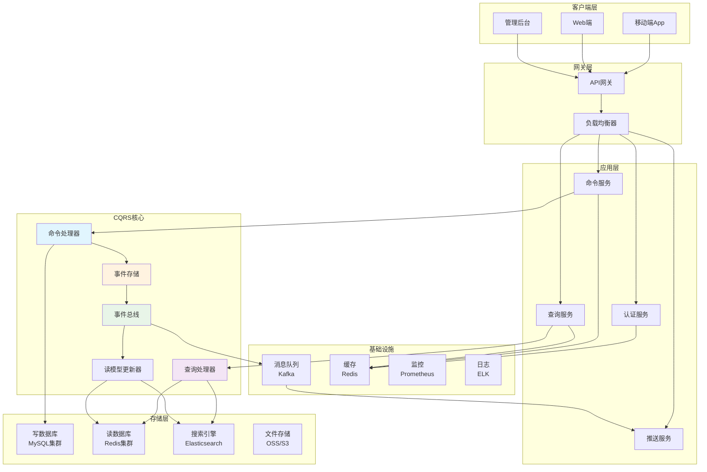

## 命令端（写操作）架构

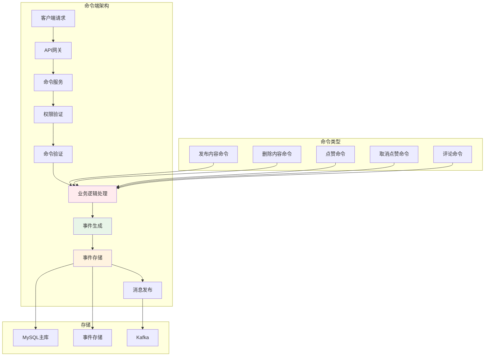

## 查询端（读操作）架构

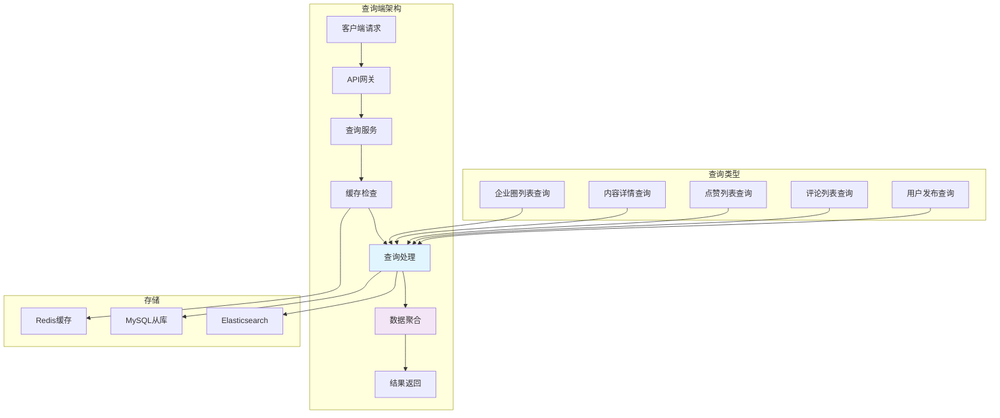

## 核心业务流程

### 发布内容流程

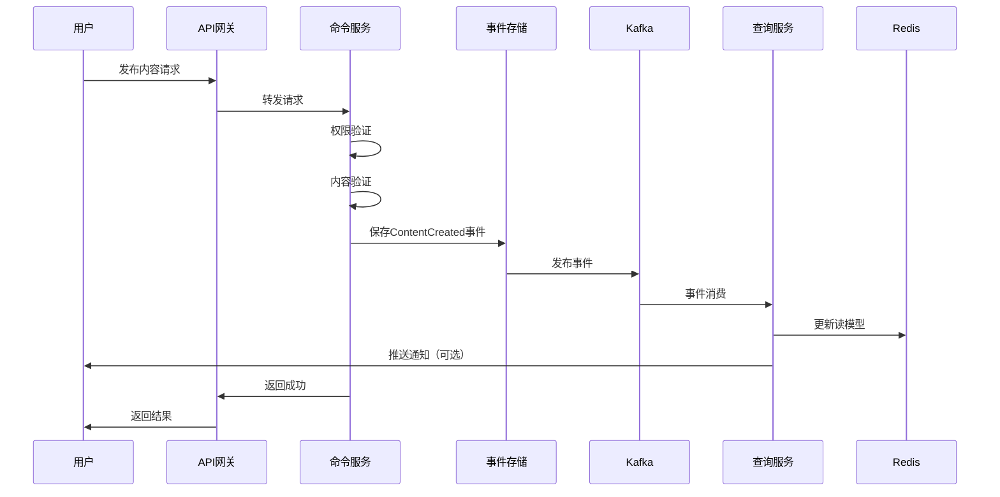

### 点赞流程

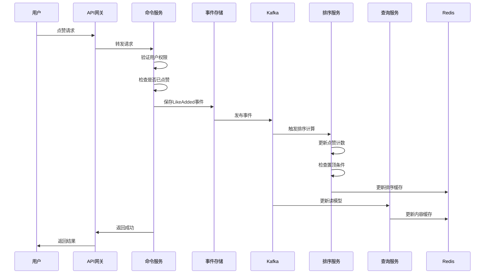

### 智能置顶算法流程

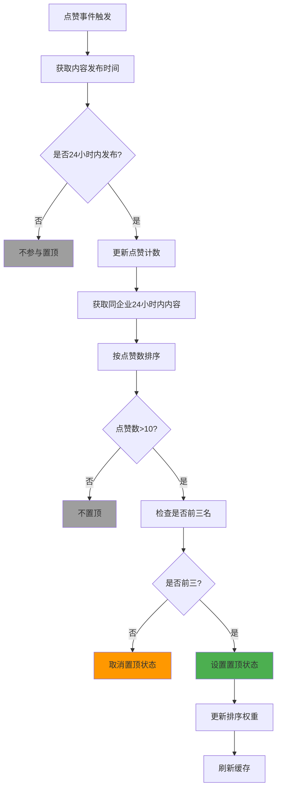

## 数据模型设计

### 命令端数据模型（MySQL）

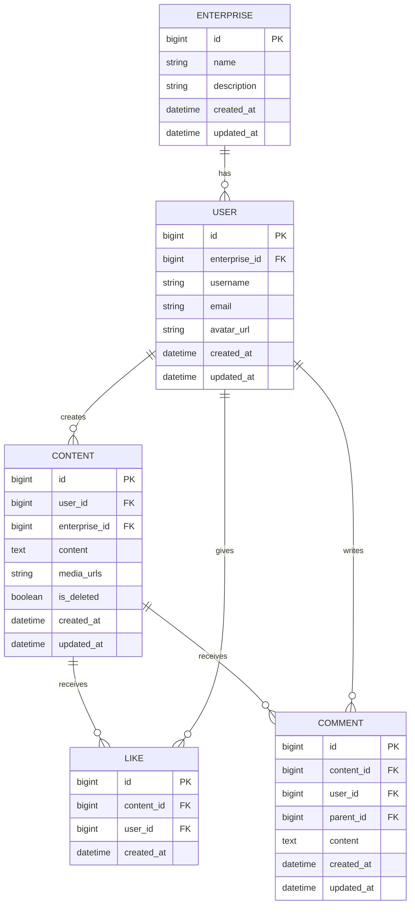

### 查询端数据模型（Redis）

```mermaid
graph LR
    subgraph "Redis数据结构"
        A[enterprise:{id}:timeline<br/>ZSET - 时间线排序]
        B[enterprise:{id}:hot<br/>ZSET - 热门排序]
        C[content:{id}<br/>HASH - 内容详情]
        D[content:{id}:likes<br/>SET - 点赞用户]
        E[content:{id}:comments<br/>LIST - 评论列表]
        F[user:{id}:contents<br/>ZSET - 用户内容]
        G[ranking:24h<br/>ZSET - 24小时热门]
    end
    
    style A fill:#e3f2fd
    style B fill:#fff3e0
    style C fill:#f3e5f5
    style D fill:#e8f5e8
    style E fill:#fce4ec
    style F fill:#fff8e1
    style G fill:#ffebee
```

## 性能优化策略

### 缓存策略

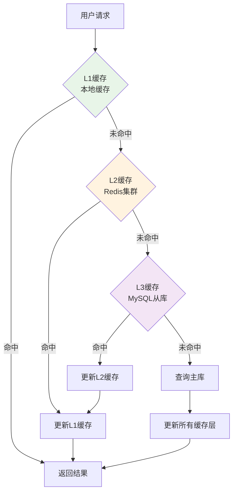

### 分片策略

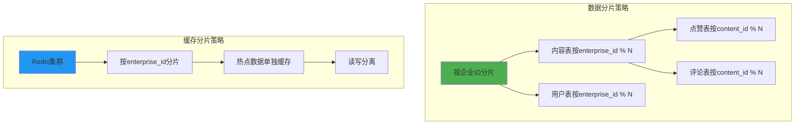

## 技术栈选型

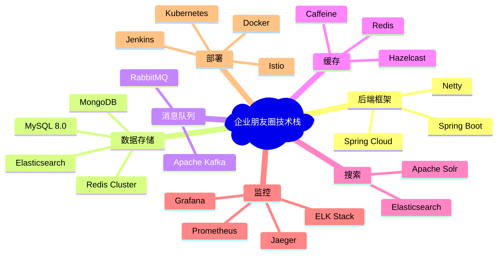

## 扩展性考虑

### 水平扩展方案

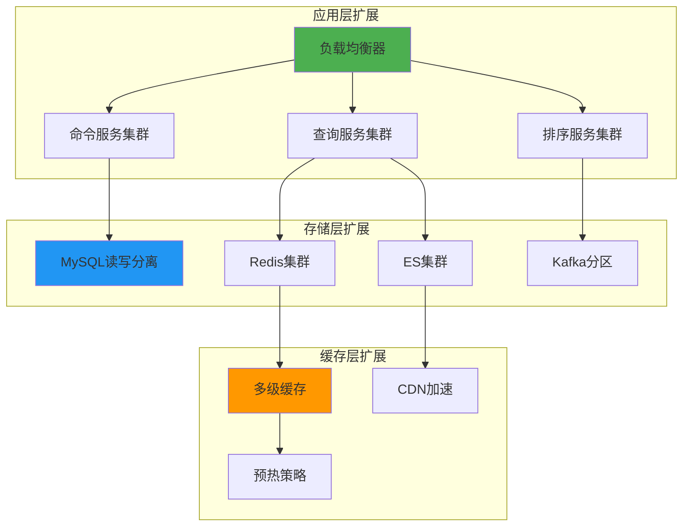

## 监控告警

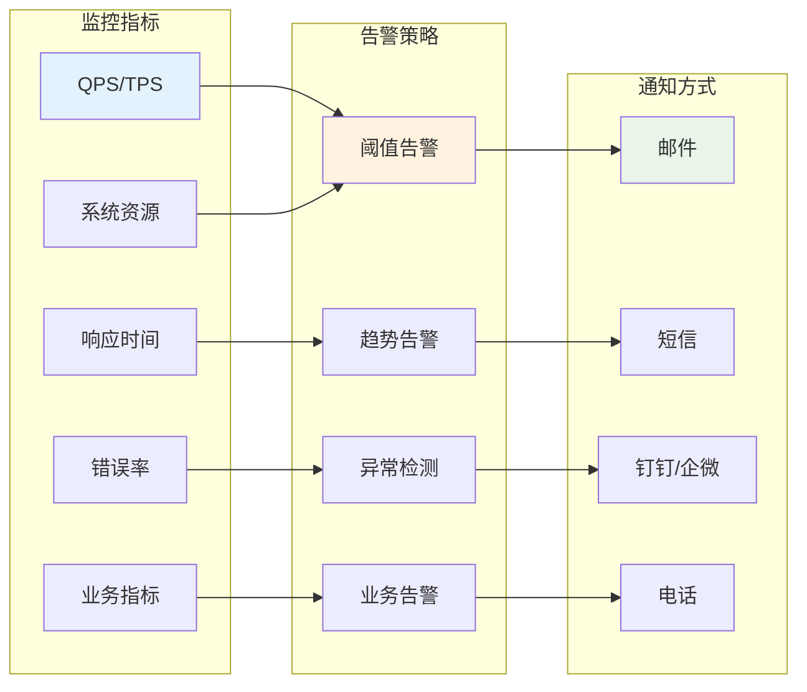

## 部署架构

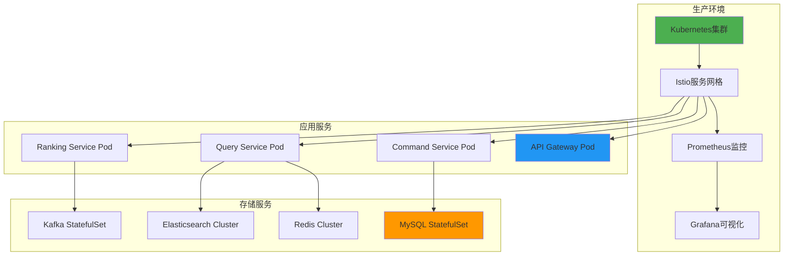

这个设计完整地实现了基于CQRS的企业朋友圈系统，具备高并发、高可用、易扩展的特点，能够支持1万企业、日增50万内容、500万日活用户的业务规模。